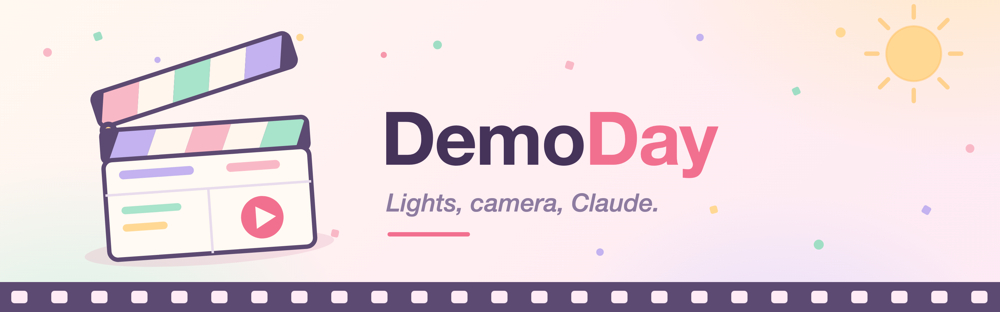

<a name="top"></a>



# DemoDay

**Your software deserves a launch video. Let Claude film it.**

DemoDay is a [Claude Code](https://claude.com/claude-code) plugin that turns any
codebase into a finished, narrated demo video. Claude reads your repo, writes the
script with you, **drives your app on screen**, narrates it with an AI voiceover —
and hands you a polished MP4 with intro, captions, transitions and an optional
on-camera presenter. One command, about the cost of a coffee. macOS only.

```
/demoday:create-demo-video
```

Not on Claude Code? DemoDay also installs as a **Codex plugin** and as an
**agent skill** (`npx skills add mrieck/demoday-claude-plugin`) for Cursor,
Copilot, Gemini CLI and every other agent that can run a shell — see
[Install](#-install).

## 🎬 See it in action

https://github.com/user-attachments/assets/8c122641-61c9-452c-aa34-293eea294419

*Sample tutorial for [Social Cue](https://trysocialcue.com), a Claude Code
plugin, in DemoDay's `dynamic` style: one AI presenter take re-framed over the
screen, everything else filmed, narrated and cut by DemoDay.*

> Like what you see? [⭐ Star the repo](https://github.com/mrieck/demoday-claude-plugin) —
> it's how people find it.

## 📱 Shorts

The same project can also be cut into a vertical **Short** for YouTube Shorts,
Instagram Reels and TikTok — say *"make a short"* (or "vertical video", "Reel",
"TikTok") and Claude picks one of the four vertical styles with you (see
[Styles](#-styles) below):

https://github.com/user-attachments/assets/5597a659-5655-4b5e-a2f7-8b77ba55d42a

*Sample listicle Short for [Social Cue](https://trysocialcue.com), a Claude
plugin that finds conversations worth joining. The presenter is an AI avatar
made from a photo of the author, speaking with a designed ElevenLabs voice; the
"it browses for you" beat is a Remotion animation instead of screen capture,
timed to the narration word by word.*

## 🎨 Styles

Every video starts from a named style — a complete look with sensible
defaults (presenter mode, captions, transitions, pacing rules) that Claude
picks with you at the start: *"which of these is it most like?"* Nine so far,
five wide and four vertical. Anything a style sets can still be changed per
scene.

**Wide (16:9)** — YouTube, a landing page, a README:

| style | feels like |
|---|---|
| `launch` | Classic product demo: presenter intro and outro, narrated screen capture, a beat of b-roll, one clear CTA |
| `anchor` | Avatar-led: the presenter is always on screen — full-frame between demos, a corner bubble over them |
| `tutorial` | Step-by-step walkthrough: the full workflow on screen, the presenter riding along as a corner bubble in one continuous take |
| `dynamic` | Dynamic tutorial: the same continuous take **re-framed** every few seconds — full-frame face, tall side panel, corner card — with animated moves between them, the screen zoomed into the element being explained, build-up captions always on. Two paces: `lively` (a move every 4–6s) or `calm` (one framing per step) |
| `explainer` | No face: motion-graphic cards and voiceover over the demos — for dev tools and infra where a stock face undercuts credibility |

**Vertical (9:16)** — YouTube Shorts, Reels, TikTok:

| style | feels like |
|---|---|
| `listicle` | "3 ways it fixes X" — numbered rundown, a cut every ~1.5s, presenter anchored under the demo, a lead-magnet CTA |
| `cohost` | Screenshare: demo on top, the presenter talking below it throughout |
| `flashcard` | Big typographic cards asking, the UI answering — no face |
| `glide` | One immersive screen recording, the camera gliding to each click, karaoke captions |

## ✨ What you get

- 🖱️ **Claude drives your app** — it rehearses off camera first, then a
  deterministic runner performs the take with smooth cursor moves and human
  typing. No dead air, no fumbling.
- 🎙️ **AI voiceover with word-timed captions** — narration is generated first,
  so every scene lands exactly on the voice.
- 🧑‍💼 **Optional on-camera presenter** — an AI presenter for the intro, outro
  and cutaways, lip-synced to the same voice as the narration.
- 🧭 **Nine named styles** — five wide (`launch`, `anchor`, `tutorial`,
  `dynamic`, `explainer`) and four vertical (`listicle`, `cohost`,
  `flashcard`, `glide`), each a complete look Claude picks with you — see
  [Styles](#-styles).
- 🗣️ **Custom character voices** — describe a voice in plain English
  (*"weathered lobster-boat captain, thick coastal accent"*) and the whole demo
  is narrated in it.
- 🎞️ **Real editing, not a screencast** — title cards, transitions,
  zoom-to-click, callouts, b-roll and audio ducking, rendered with
  [Remotion](https://remotion.dev).
- 📱 **Vertical Shorts too** — cut a 15–45s 9:16 Short (YouTube Shorts,
  Reels, TikTok) from the same project, with its own frame-0 hook card so the
  thumbnail is never a random frame.
- 💻 **Films almost anything on a Mac** — web apps, native macOS apps, and
  CLI/terminal programs (yes, it can demo a Claude Code plugin from inside a
  live `claude` session).
- 🔁 **Cheap to iterate** — change one line of narration and only that line is
  regenerated. A cost estimate is shown *before* anything is spent.

## 🚀 Install

In Claude Code:

```
/plugin marketplace add mrieck/claude-plugins
/plugin install demoday@productive-mark
```

(`productive-mark` is the marketplace, hosted in
[mrieck/claude-plugins](https://github.com/mrieck/claude-plugins); `demoday` is
the plugin — this repo.)

That's it for software — no `npm install`, no manual dependency setup. The first
time you run `/demoday:create-demo-video`, Claude checks your machine and
installs anything missing (Node packages, a capture browser, ffmpeg) before
filming starts.

Desktop scrolling also needs Xcode Command Line Tools (`xcode-select --install`).
The capture tool compiles a small native scroll helper once and caches it in the
temporary directory; `doctor.mjs` checks that the Swift compiler is available.

> **Requirements:** macOS and [Claude Code](https://claude.com/claude-code) —
> or Codex, or any agent that can run a shell (both below). The only thing the
> agent can't do for you is the two steps that follow.

<details>
<summary><b>Codex</b></summary>

DemoDay ships a Codex plugin manifest (`.codex-plugin/`), so the same repo
installs into Codex with its skills and the `demo-stage` MCP server:

```bash
codex plugin marketplace add mrieck/demoday-claude-plugin
codex plugin add demoday@demoday
```

Then, in a Codex session in the repo you want filmed, ask for a demo video
(the `demo-video` skill) and let it run the preflight — `node
scripts/doctor.mjs --install` inside the plugin directory — which installs
the Node packages and Chromium the MCP server needs. Reload plugins or restart
Codex once after that so the server starts with its packages present.

</details>

<details>
<summary><b>Cursor, Copilot, Gemini CLI, OpenCode… (any agent, via <code>npx skills</code>)</b></summary>

The repo is also a self-contained [agent skill](https://skills.sh) — one folder
with the scripts, the rehearsal server and the craft guides:

```bash
npx skills add mrieck/demoday-claude-plugin        # pick your agent(s) when prompted
npx skills add mrieck/demoday-claude-plugin -g -a cursor -a codex -y   # or non-interactively
```

Then ask your agent for a demo video. The skill tells it to run
`node scripts/doctor.mjs --install` first, and to drive the app either through
the `demo-stage` MCP server (if your agent supports MCP — one line of config,
shown in the skill) or through `node scripts/stage.mjs`, a shell client for
the very same server. Every capability is identical; only the way the agent
reaches the rehearsal tools differs.

</details>

### 1. Add your fal.ai key (required)

All generation — voice, presenter, b-roll — runs through
[fal.ai](https://fal.ai/dashboard/keys). Store the key in your macOS Keychain by
running this **in your own terminal** (not through Claude, so the key never
touches a transcript):

```bash
security add-generic-password -s demoday -a FAL_API_KEY -w
```

It prompts for the key without echoing it. A typical 30-second demo costs
**$1–2 in fal credits**.

Not on Keychain terms? Every other place a key can live is covered in
[HOW_IT_WORKS.md](HOW_IT_WORKS.md#where-api-keys-can-live).

### 2. Grant screen permissions (desktop capture only)

To film a **native Mac app**, give the terminal you run Claude Code from
(Terminal, iTerm, VS Code…) **Screen Recording** and **Accessibility** in System
Settings → Privacy & Security, then restart the terminal. Filming web apps and
CLI demos in a staged terminal window needs no permissions at all — and if
anything's missing, Claude tells you the exact Settings pane during preflight.

### Optional keys

Same Keychain one-liner, different account name:

- **`ELEVENLABS_API_KEY`** — unlocks custom character voices via
  [ElevenLabs Voice Design](https://try.elevenlabs.io/zecjglkbwy6x)
  *(affiliate link)*, and **sound effects**: a per-project pack of cues
  (whoosh, pop, hit, tick, riser) generated from text prompts and fired
  automatically on transitions, insert cards, `#N` stamps, punch-ins and bullet
  reveals — ~$0.02 a take, three takes per cue, pick your favourite. Needs a
  paid ElevenLabs plan (Starter and up): the free tier blocks voice
  creation over the API, and a paid plan also carries the commercial license
  you'd want for a published video anyway.
- **`BRAVE_API_KEY`** — lets b-roll generation search reference images.

## 🔒 What leaves your machine

Screen recordings, rehearsal screenshots and the finished MP4 stay local. Only
what generation needs is uploaded: narration text, narration audio, the
presenter image and b-roll frames go to [fal.ai](https://fal.ai) — and
narration text to [ElevenLabs](https://elevenlabs.io) if you use it. API keys
are only ever read, never written
([details](HOW_IT_WORKS.md#where-api-keys-can-live)).

## 🎥 Make your first video

From the repo of the software you want to show off:

```
/demoday:create-demo-video
```

Claude will read the codebase, pitch you two or three flows worth filming, ask
about goal, audience, length and presenter style, and show you the cost estimate.
Only after you say yes does it generate a single frame. Ten-ish minutes later
there's an MP4 in that video's project folder under `demo/` (each video gets its
own, e.g. `demo/project-overview/`).

## 🔍 Under the hood

The interesting bits — the two-pass rehearse/perform design, narration-first
pacing, the `demo.json` manifest, content-addressed caching, and everything about
API-key resolution — live in [HOW_IT_WORKS.md](HOW_IT_WORKS.md).

Meme-style cold opens (reaction clip + slow-mo cutout + freeze frame + music + push-in) are declared as a `composite` block on a scene and baked by `scripts/edit/composite.mjs`; `scripts/gen/fetch-audio.mjs` pulls a music cue with yt-dlp; `scripts/gen/sfx.mjs` designs the sound-effect pack and `scripts/lib/sfx.mjs` places every cue on the absolute timeline before the render. Every render rewrites `SCRIPT.md` from the manifest so downstream tools (cross-posting) always read the current cut.

## 🤖 Automation and social media

**Want Claude to make videos while you sleep?** [Overboard](https://tryoverboard.com)
is a Mac app that runs Claude Code agents 24/7 on the Claude subscription you
already pay for. Put `/demoday:create-demo-video` on its scheduler and wake up
to a rendered demo of last night's release, or dispatch a video from your phone
over Telegram or Slack and let your Mac do the rest. No cloud server, no API
bill. [tryoverboard.com](https://tryoverboard.com)

**Need a social media tool to grow your brand?** [Social Cue](https://trysocialcue.com)
is a Claude Code plugin that finds the Reddit, Hacker News and X conversations
your customers are already having, drafts replies in your voice, and cross-posts
your DemoDay Shorts to YouTube, TikTok and Instagram with a title, post text
and hashtags written for each platform. (The on-screen captions are burned into
the video by DemoDay itself.) Every video on this README was scheduled with it.
[trysocialcue.com](https://trysocialcue.com)

## ⭐ If this saved you an afternoon

DemoDay is free and built by one person. If it made you a video you'd
actually post, **a star on this repo** is the thing that helps other people
find it — and it tells me which parts to keep building.

[](https://github.com/mrieck/demoday-claude-plugin)

## 📄 License notes

Rendering uses Remotion, which is free for individuals and small companies but
needs a paid license above a headcount threshold — see
[remotion.dev/license](https://remotion.dev/license). Voices generated on a paid
ElevenLabs plan include commercial usage rights.

To subscribe to an ElevenLabs plan that allows commercial use,
[click here](https://try.elevenlabs.io/zecjglkbwy6x) *(affiliate link)*.

DemoDay itself is [MIT licensed](LICENSE).
